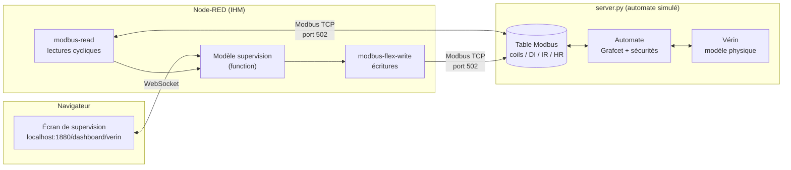
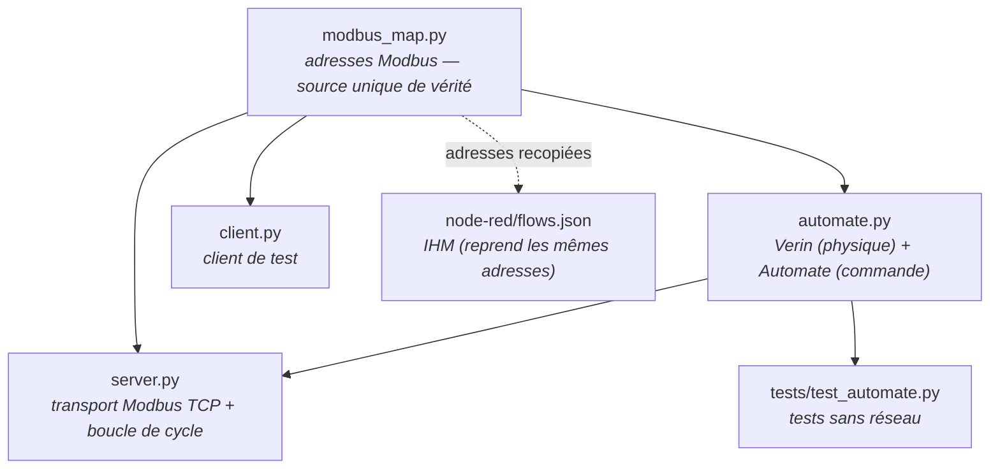
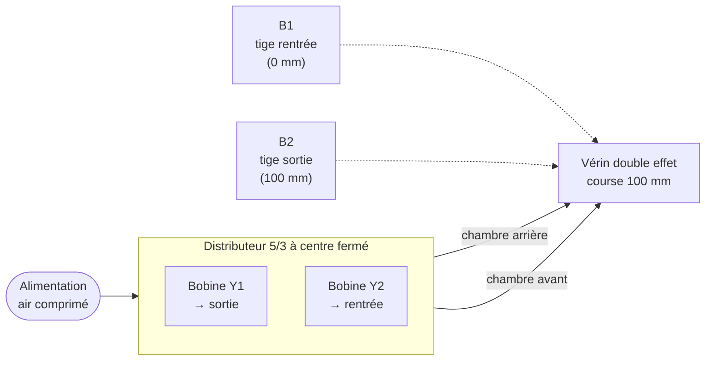
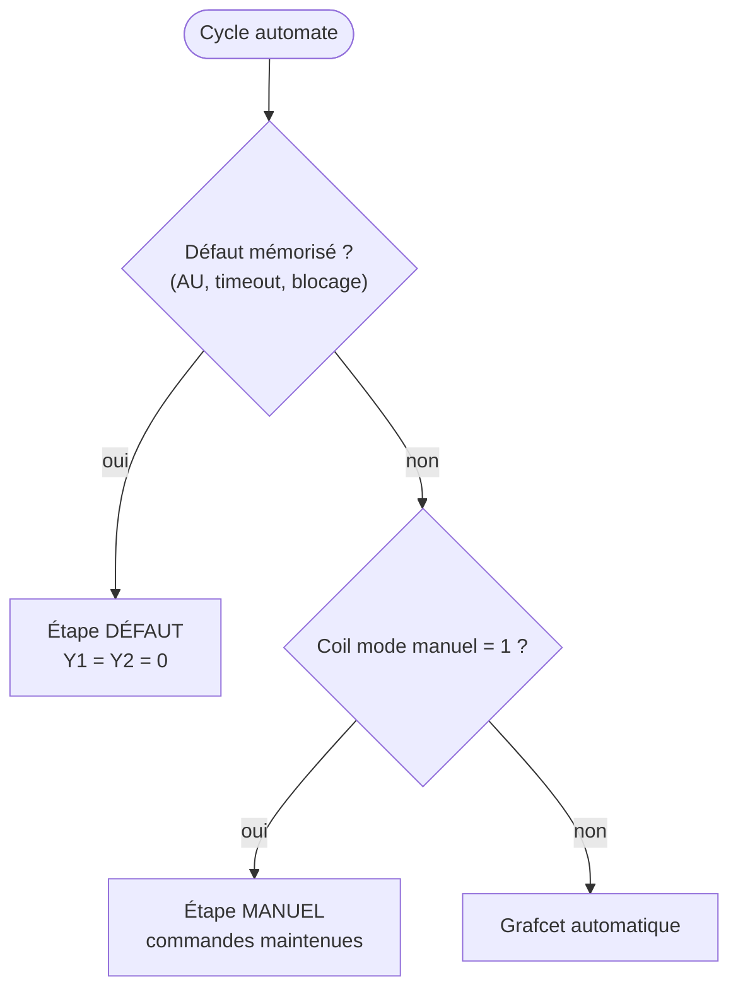
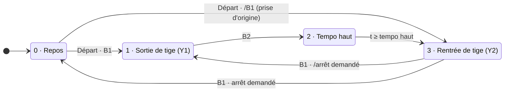
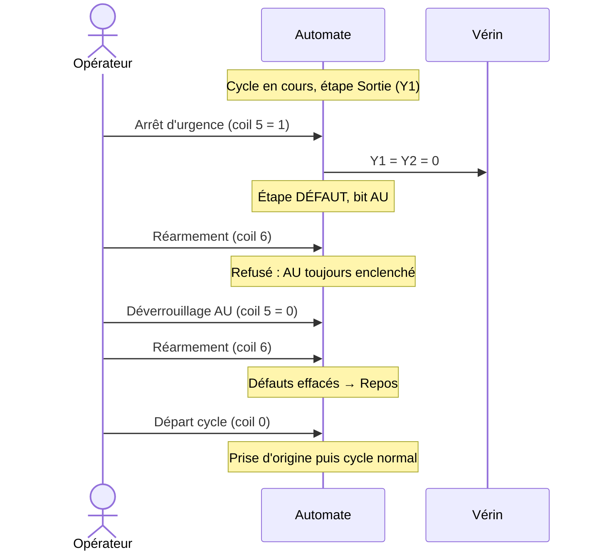
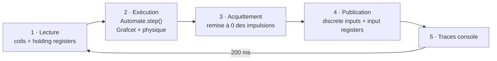
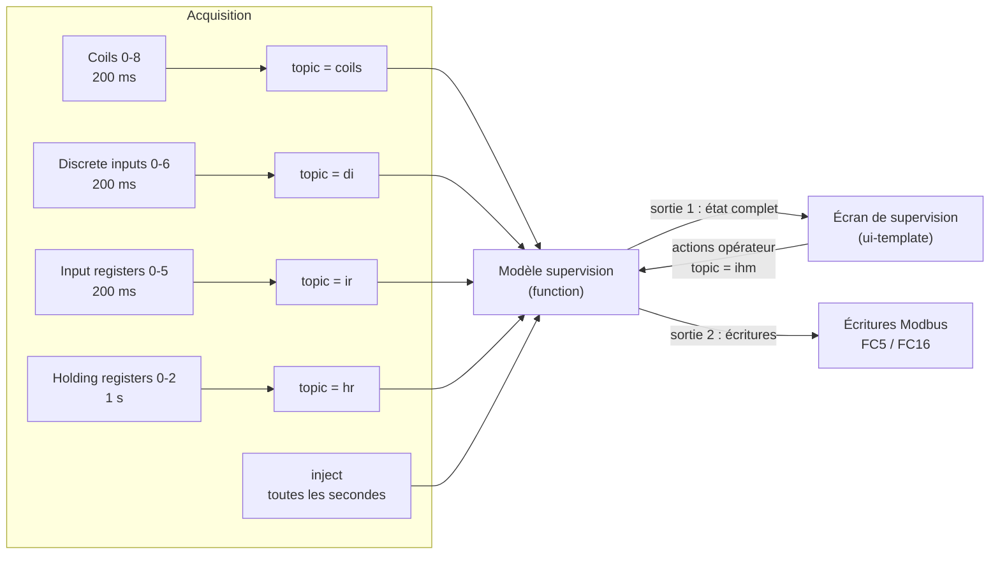

# tp-simu-auto — Simulation d'un automate pilotant un vérin pneumatique

Ce projet simule un **automate programmable (API / PLC)** qui commande un
**vérin pneumatique double effet Festo**. L'automate est exposé sur le réseau
en **Modbus TCP**, et une **IHM de supervision Node-RED** permet de le piloter
et de le surveiller depuis un navigateur.

Comme avec un vrai automate industriel, **toutes les données échangées passent
par la table Modbus**. L'IHM n'a aucun accès direct au code Python : elle ne
fait que lire et écrire des coils et des registres.

---

## Sommaire

1. [Vue d'ensemble](#1-vue-densemble)
2. [Organisation du dépôt](#2-organisation-du-dépôt)
3. [Le système simulé](#3-le-système-simulé)
4. [Logique de commande](#4-logique-de-commande)
5. [Table d'échange Modbus](#5-table-déchange-modbus)
6. [Le serveur Modbus (`server.py`)](#6-le-serveur-modbus-serverpy)
7. [L'IHM de supervision Node-RED](#7-lihm-de-supervision-node-red)
8. [Installation et lancement](#8-installation-et-lancement)
9. [Tests](#9-tests)
10. [Scénarios de démonstration](#10-scénarios-de-démonstration)
11. [Choix techniques](#11-choix-techniques)

---

## 1. Vue d'ensemble



| Composant                 | Technologie                     | Rôle                                                                 |
|---------------------------|---------------------------------|----------------------------------------------------------------------|
| Automate simulé           | Python 3.13 + pymodbus 3.15     | Grafcet, sécurités et physique du vérin, exécutés toutes les 0,2 s   |
| Communication             | Modbus TCP (port 502, esclave 1)| Seul moyen d'échange entre l'IHM et l'automate                       |
| IHM de supervision        | Node-RED 5 + Dashboard 2.0      | Synoptique, commandes, alarmes, journal, tendance, réglages          |
| Client de test            | Python (`client.py`)            | Test en ligne de commande : un cycle automatique puis arrêt          |
| Tests unitaires           | `unittest`                      | Vérification de la logique de l'automate, sans réseau                |

---

## 2. Organisation du dépôt

```
tp-simu-auto/
├── README.md                  ← ce document
├── pyproject.toml             ← projet Python (dépendance : pymodbus)
├── uv.lock                    ← versions exactes des dépendances
├── server.py                  ← serveur Modbus TCP = l'automate simulé
├── client.py                  ← client Modbus de test (sans IHM)
├── src/tp_simu_auto/
│   ├── modbus_map.py          ← table d'échange Modbus (adresses, échelles)
│   └── automate.py            ← modèle du vérin + logique de commande
├── tests/
│   └── test_automate.py       ← tests unitaires de la logique
└── node-red/
    ├── flows.json             ← flow Node-RED de l'IHM (à importer)
    └── README.md              ← installation et contenu du flow
```

Le code est découpé en **couches indépendantes** :



- `modbus_map.py` est le **seul endroit** où les adresses Modbus sont définies.
  Le serveur et le client l'importent, et aucune adresse n'est écrite en dur
  ailleurs dans le code Python.
- `automate.py` ne connaît pas Modbus. On peut donc tester toute la logique
  sans lancer de serveur.

---

## 3. Le système simulé

### 3.1 Partie opérative



| Élément                 | Caractéristique                                                    |
|-------------------------|--------------------------------------------------------------------|
| Vérin                   | Double effet, course **100 mm**                                    |
| Vitesse de sortie       | **25 mm/s** (bobine Y1) → sortie complète en 4 s                   |
| Vitesse de rentrée      | **20 mm/s** (bobine Y2) → rentrée complète en 5 s                  |
| Distributeur            | **5/3 à centre fermé** : aucune bobine → tige immobile             |
| Capteur B1              | Fin de course basse : vrai quand position ≤ 0 mm                   |
| Capteur B2              | Fin de course haute : vrai quand position ≥ 100 mm                 |
| Pression d'air basse    | Défaut simulé : vitesses réduites à **30 %**                       |
| Blocage mécanique       | Défaut simulé : la tige ne bouge plus                              |

### 3.2 Modèle physique (classe `Verin`)

À chaque cycle de durée `dt`, la position est intégrée :

| Bobines         | Effet                                                          |
|-----------------|----------------------------------------------------------------|
| Y1 = 1, Y2 = 0  | `position += 25 × facteur × dt`, bornée à 100 mm               |
| Y1 = 0, Y2 = 1  | `position −= 20 × facteur × dt`, bornée à 0 mm                 |
| Y1 = Y2         | Tige immobile (centre fermé, ou commandes contradictoires)     |
| Blocage simulé  | Tige immobile quelles que soient les bobines                   |

`facteur` vaut 1, ou 0,3 si la simulation « pression basse » est active.

---

## 4. Logique de commande

La classe `Automate` choisit à chaque cycle **un mode de fonctionnement**,
par ordre de priorité :



### 4.1 Mode automatique (Grafcet)



| Étape | Nom          | Action  | Transition de sortie                                         |
|-------|--------------|---------|--------------------------------------------------------------|
| 0     | Repos        | —       | Départ cycle (vers 1 si B1, sinon vers 3 : prise d'origine)   |
| 1     | Sortie       | Y1      | B2 atteint → 2 ; au-delà du temps max de sortie → défaut     |
| 2     | Tempo haut   | —       | Temporisation écoulée (1 s par défaut) → 3                   |
| 3     | Rentrée      | Y2      | B1 atteint → 1, ou → 0 si un arrêt a été demandé ; au-delà du temps max de rentrée → défaut |

- **Cycle continu** : la tige fait des allers-retours tant qu'aucun arrêt n'est
  demandé.
- **Arrêt en fin de cycle** : une demande d'arrêt est mémorisée et n'est
  exécutée qu'une fois la **tige rentrée** (B1). Le vérin s'arrête donc
  toujours dans sa position de sécurité.
- **Prise d'origine** : si la tige n'est pas rentrée au départ, le cycle
  commence par une rentrée.
- **Mesures** : l'automate mesure la durée de chaque sortie et de chaque
  rentrée, et compte les cycles complets.

Durée d'un cycle avec les paramètres par défaut :

| Phase        | Durée                       |
|--------------|-----------------------------|
| Sortie       | 100 mm / 25 mm/s = **4 s**  |
| Tempo haut   | **1 s**                     |
| Rentrée      | 100 mm / 20 mm/s = **5 s**  |
| **Total**    | **≈ 10 s**                  |

### 4.2 Mode manuel

Les commandes sont **à action maintenue** : la tige se déplace tant que
l'opérateur garde le bouton appuyé.

| Commande                       | Résultat                                    |
|--------------------------------|---------------------------------------------|
| Sortie maintenue, tige < 100 mm| Y1 = 1                                      |
| Rentrée maintenue, tige > 0 mm | Y2 = 1                                      |
| Bouton relâché                 | Y1 = Y2 = 0, tige immobile                  |
| Fin de course atteinte         | Bobine coupée automatiquement               |
| Sortie **et** rentrée ensemble | Verrouillage : aucune bobine                |

Le passage en manuel **interrompt** le cycle automatique en cours.

### 4.3 Sécurités et défauts

| Bit | Défaut                  | Condition de détection                                         |
|-----|-------------------------|----------------------------------------------------------------|
| 0   | Arrêt d'urgence         | Coil AU = 1                                                    |
| 1   | Timeout sortie          | B2 non atteint après le temps max de sortie (8 s par défaut)   |
| 2   | Timeout rentrée         | B1 non atteint après le temps max de rentrée (10 s par défaut) |
| 3   | Vérin bloqué            | Bobine commandée mais tige immobile pendant **1 s**            |

Règles de sécurité :

1. Tout défaut **coupe Y1 et Y2** et **interrompt le cycle**.
2. Les défauts restent **mémorisés** jusqu'au réarmement, même si leur cause
   a disparu.
3. L'arrêt d'urgence doit être **déverrouillé avant** de pouvoir réarmer.
   Sinon, le défaut AU reste actif.
4. Après réarmement, l'automate revient au **Repos**, ou en **Manuel** si ce
   mode est sélectionné. Le cycle ne redémarre **jamais tout seul** : il faut
   un nouveau départ.



---

## 5. Table d'échange Modbus

Elle est définie dans `src/tp_simu_auto/modbus_map.py`. Serveur :
`127.0.0.1:502`, identifiant d'esclave **1**.

### Coils : commandes de l'IHM (lecture/écriture, FC1 / FC5)

| Adr. | Nom                        | Type        | Rôle                                   |
|------|----------------------------|-------------|----------------------------------------|
| 0    | `COIL_DEPART_CYCLE`        | Impulsion   | Départ du cycle automatique            |
| 1    | `COIL_ARRET_CYCLE`         | Impulsion   | Arrêt en fin de cycle                  |
| 2    | `COIL_MODE_MANUEL`         | Maintenu    | 0 = automatique, 1 = manuel            |
| 3    | `COIL_JOG_SORTIE`          | Maintenu    | Manuel : sortie de tige                |
| 4    | `COIL_JOG_RENTREE`         | Maintenu    | Manuel : rentrée de tige               |
| 5    | `COIL_ARRET_URGENCE`       | Maintenu    | Arrêt d'urgence enclenché              |
| 6    | `COIL_REARMEMENT`          | Impulsion   | Réarmement des défauts                 |
| 7    | `COIL_SIMU_BLOCAGE`        | Maintenu    | Simulation : blocage mécanique         |
| 8    | `COIL_SIMU_PRESSION_BASSE` | Maintenu    | Simulation : pression d'air basse      |

> Les **impulsions** sont remises à 0 par l'automate dès qu'il les a prises en
> compte. L'IHM n'a donc qu'à écrire 1.

### Discrete inputs : état de l'automate (lecture seule, FC2)

| Adr. | Nom                    | Rôle                                    |
|------|------------------------|-----------------------------------------|
| 0    | `DI_Y1_SORTIE`         | Bobine Y1 alimentée                     |
| 1    | `DI_Y2_RENTREE`        | Bobine Y2 alimentée                     |
| 2    | `DI_B1_TIGE_RENTREE`   | Capteur B1                              |
| 3    | `DI_B2_TIGE_SORTIE`    | Capteur B2                              |
| 4    | `DI_CYCLE_EN_COURS`    | Cycle automatique en cours              |
| 5    | `DI_DEFAUT`            | Au moins un défaut actif                |
| 6    | `DI_ARRET_FIN_CYCLE`   | Arrêt demandé, en attente de fin de cycle |

### Input registers : mesures (lecture seule, FC4)

| Adr. | Nom                  | Unité        | Rôle                                               |
|------|----------------------|--------------|----------------------------------------------------|
| 0    | `IR_POSITION_TIGE`   | mm × 10      | Position de la tige (1000 = 100,0 mm)              |
| 1    | `IR_ETAPE`           | —            | 0 Repos, 1 Sortie, 2 Tempo haut, 3 Rentrée, 4 Manuel, 5 Défaut |
| 2    | `IR_DEFAUTS`         | bits         | Mot de défauts (voir tableau 4.3)                  |
| 3    | `IR_CYCLES`          | —            | Nombre de cycles complets (modulo 65 536)          |
| 4    | `IR_DUREE_SORTIE`    | 0,1 s        | Durée de la dernière sortie                        |
| 5    | `IR_DUREE_RENTREE`   | 0,1 s        | Durée de la dernière rentrée                       |

### Holding registers : paramètres (lecture/écriture, FC3 / FC6 / FC16)

| Adr. | Nom                    | Unité  | Défaut       | Rôle                                  |
|------|------------------------|--------|--------------|---------------------------------------|
| 0    | `HR_TEMPO_HAUT`        | 0,1 s  | 10 (1 s)     | Temporisation en position haute       |
| 1    | `HR_TIMEOUT_SORTIE`    | 0,1 s  | 80 (8 s)     | Temps maximal pour atteindre B2       |
| 2    | `HR_TIMEOUT_RENTREE`   | 0,1 s  | 100 (10 s)   | Temps maximal pour atteindre B1       |

Les registres étant des entiers 16 bits, les valeurs décimales sont transmises
avec un **facteur d'échelle** : ×10 pour la position (résolution 0,1 mm) et
pour les durées (résolution 0,1 s). L'automate impose un minimum de 1 s aux
temps maximaux, pour qu'un mauvais réglage ne puisse pas bloquer la machine.

---

## 6. Le serveur Modbus (`server.py`)

Le serveur reproduit le **cycle d'un automate réel** : lecture des entrées,
exécution du programme, écriture des sorties, toutes les **200 ms**.



- Le serveur Modbus (`ModbusTcpServer`) et la boucle de simulation tournent
  dans la même boucle `asyncio`. Ils accèdent à la mémoire Modbus par
  `async_getValues` et `async_setValues`.
- La mémoire est construite avec l'API `SimData` / `SimDevice` de
  pymodbus 3.15, qui remplace les anciens `ModbusSequentialDataBlock`
  (dépréciés).
- La console affiche chaque changement d'étape, chaque changement de défauts
  et un état résumé toutes les secondes :

```
[AUTOMATE] Modbus TCP en ecoute sur le port 502 (Ctrl+C pour arreter)
[AUTOMATE] Etape REPOS -> SORTIE
[AUTOMATE] etape=SORTIE     Y1=1 Y2=0 position=  25.0 mm cycles=0
[AUTOMATE] Etape SORTIE -> TEMPO_HAUT
```

---

## 7. L'IHM de supervision Node-RED

### 7.1 Structure du flow (`node-red/flows.json`)



| Nœud                      | Type                | Rôle                                                                 |
|---------------------------|---------------------|----------------------------------------------------------------------|
| Automate (server.py)      | `modbus-client`     | Connexion TCP à 127.0.0.1:502                                        |
| Coils / DI / IR / HR      | `modbus-read`       | Lectures cycliques de toute la table                                 |
| topic = …                 | `change`            | Étiquette chaque lecture pour le modèle                              |
| Toutes les secondes       | `inject`            | Horloge de surveillance de la communication                          |
| Modèle supervision        | `function`          | État machine, alarmes, journal, conversion des actions en écritures  |
| Écran de supervision      | `ui-template`       | Interface opérateur (HTML / Vue.js)                                  |
| Écritures Modbus          | `modbus-flex-write` | FC5 (écriture d'un coil) et FC16 (écriture des 3 paramètres)         |

### 7.2 Le nœud « Modèle supervision »

C'est la logique de l'IHM. Il ne contient **aucune logique de commande du
vérin**, qui reste dans l'automate. Il :

- regroupe les quatre lectures Modbus en un **état complet** envoyé à l'écran ;
- détecte la **perte de communication** : pas de lecture depuis plus d'1 s ;
- gère les **alarmes** : une alarme apparaît quand un bit de défaut passe à 1
  et reste affichée tant qu'elle est active **ou** non acquittée ;
- tient un **journal horodaté** des 100 derniers événements (actions
  opérateur, alarmes, changements d'état) ;
- traduit les **actions de l'opérateur** en écritures Modbus :

| Action IHM               | Écriture Modbus                                         |
|--------------------------|---------------------------------------------------------|
| Départ cycle             | Coil 0 ← 1 (FC5)                                        |
| Arrêt fin de cycle       | Coil 1 ← 1 (FC5)                                        |
| Choix AUTO / MANUEL      | Coils 3 et 4 ← 0, puis coil 2 ← mode (FC5)              |
| Bouton sortie / rentrée  | Coil 3 ou 4 ← 1 à l'appui, 0 au relâchement (FC5)       |
| Arrêt d'urgence          | Coil 5 ← 1 / 0 (FC5)                                    |
| Acquitter / réarmer      | Coil 6 ← 1 (FC5) + acquittement des alarmes affichées   |
| Simulation de défaut     | Coil 7 ou 8 ← 1 / 0 (FC5)                               |
| Valider les paramètres   | HR 0-2 ← valeurs × 10 (FC16), refusées si hors 0–600 s  |

États machine affichés dans le bandeau, par ordre de priorité :

| Priorité | État             | Condition                         |
|----------|------------------|-----------------------------------|
| 1        | HORS LIGNE       | Communication perdue              |
| 2        | ARRÊT D'URGENCE  | Coil AU = 1                       |
| 3        | EN DÉFAUT        | Mot de défauts ≠ 0                |
| 4        | MANUEL           | Coil mode manuel = 1              |
| 5        | EN CYCLE         | Cycle en cours                    |
| 6        | À L'ARRÊT        | Sinon                             |

### 7.3 L'écran de supervision

Adresse : **http://localhost:1880/dashboard/verin**

| Zone              | Contenu                                                                                 |
|-------------------|-----------------------------------------------------------------------------------------|
| Bandeau           | État de la communication, mode, état machine, horloge, alarme en cours                  |
| Synoptique animé  | Vérin, capteurs B1/B2, distributeur 5/3, conduites sous pression ; barre de position verte en sortie, rouge en rentrée ; « HAUTEUR MAX / MIN » clignotant en butée |
| Commande          | Choix AUTO / MANUEL, départ et arrêt de cycle, Grafcet animé, boutons de déplacement manuel à action maintenue, arrêt d'urgence, acquittement / réarmement |
| Alarmes           | Liste des alarmes, clignotantes tant qu'elles ne sont pas acquittées                    |
| Journal           | Événements horodatés (opérateur, alarmes, informations, simulations)                    |
| Tendance          | Courbe de la position sur les 60 dernières secondes                                     |
| Mesures           | Y1, Y2, B1, B2, nombre de cycles, durées de sortie et de rentrée                        |
| Réglages          | Paramètres de l'automate et simulation de défauts                                       |

---

## 8. Installation et lancement

### 8.1 Prérequis

| Logiciel  | Version testée | Rôle                                   |
|-----------|----------------|----------------------------------------|
| Python    | 3.13           | Automate simulé                        |
| uv        | —              | Gestion de l'environnement Python      |
| Node.js   | 26             | Exécution de Node-RED                  |
| Node-RED  | 5.0.10         | IHM                                    |
| `node-red-contrib-modbus`      | 5.62.1 | Nœuds Modbus TCP          |
| `@flowfuse/node-red-dashboard` | 1.37.0 | Dashboard 2.0             |
| pymodbus  | 3.15.0         | Serveur Modbus (installé par `uv sync`) |

### 8.2 Installation (une seule fois)

```powershell
# Dépendances Python
uv sync

# Node-RED et ses modules
npm.cmd install -g --unsafe-perm node-red
cd $env:USERPROFILE\.node-red
npm.cmd install node-red-contrib-modbus @flowfuse/node-red-dashboard
```

Il faut ensuite importer l'IHM : lancer Node-RED, ouvrir http://localhost:1880,
puis menu ☰ → **Import** → `node-red/flows.json` → **Import** → **Deploy**.
Plus de détails dans [node-red/README.md](node-red/README.md).

### 8.3 Lancement

```powershell
uv run python server.py     # terminal 1 : l'automate
node-red.cmd                # terminal 2 : l'IHM
```

Puis ouvrir **http://localhost:1880/dashboard/verin**.

### 8.4 Test sans IHM

```powershell
uv run python server.py     # terminal 1
uv run python client.py     # terminal 2 : un cycle automatique puis arrêt
```

> Ne pas lancer `client.py` en même temps que l'IHM, car les deux écriraient
> dans les mêmes coils. `server.py` et `client.py` acceptent un numéro de port
> en argument (ex. `uv run python server.py 5020`).

---

## 9. Tests

```powershell
uv run python -m unittest discover -s tests
```

Les tests appellent directement `Automate.step()` avec un pas de 0,1 s, sans
réseau. Ils sont donc rapides (11 tests en quelques millisecondes) et ne
dépendent ni de Modbus ni de Node-RED.

| Test                                               | Ce qui est vérifié                                                  |
|----------------------------------------------------|---------------------------------------------------------------------|
| `test_cycle_complet_puis_arret_en_fin_de_cycle`    | Enchaînement des étapes, arrêt exécuté tige rentrée, mesures        |
| `test_cycle_continu_sans_arret`                    | Le cycle se répète tant qu'aucun arrêt n'est demandé                |
| `test_prise_d_origine_si_tige_sortie`              | Départ tige sortie : le cycle commence par une rentrée              |
| `test_jog_deplace_et_arrete_la_tige`               | Manuel : déplacement pendant l'appui, arrêt au relâchement          |
| `test_jog_s_arrete_en_fin_de_course`               | Manuel : bobine coupée en butée                                     |
| `test_commandes_contradictoires_sans_effet`        | Sortie + rentrée simultanées : aucune bobine                        |
| `test_passage_en_manuel_interrompt_le_cycle`       | Le mode manuel interrompt le cycle automatique                      |
| `test_arret_urgence_coupe_et_exige_deverrouillage` | AU : bobines coupées, réarmement refusé tant que l'AU est enclenché |
| `test_blocage_mecanique`                           | Détection du vérin bloqué                                           |
| `test_pression_basse_declenche_timeout_sortie`     | Pression basse : B2 non atteint à temps → défaut                    |
| `test_rearmement_puis_redemarrage`                 | Après réarmement, retour au repos puis redémarrage possible         |

---

## 10. Scénarios de démonstration

À dérouler depuis l'écran de supervision, avec `server.py` lancé.

| # | Scénario              | Manipulation                                                   | Résultat attendu                                                                 |
|---|-----------------------|----------------------------------------------------------------|----------------------------------------------------------------------------------|
| 1 | Cycle automatique     | Mode AUTO → **Départ**                                         | Allers-retours de la tige (≈ 10 s par cycle), Grafcet animé, compteur de cycles  |
| 2 | Arrêt en fin de cycle | Pendant une sortie → **Arrêt**                                 | Le vérin termine son cycle et s'arrête tige rentrée                              |
| 3 | Mode manuel           | Mode MANUEL → maintenir **Sortie**, puis relâcher              | La tige sort pendant l'appui et s'arrête au relâchement ou en butée              |
| 4 | Arrêt d'urgence       | Pendant un cycle → **AU**, puis réarmer sans déverrouiller     | Bobines coupées, alarme ; le réarmement est refusé tant que l'AU est enclenché   |
| 5 | Pression basse        | Activer « pression basse » → **Départ**                        | Tige à 7,5 mm/s : B2 non atteint en 8 s → alarme « Défaut sortie »               |
| 6 | Blocage mécanique     | Pendant un mouvement → activer « blocage »                     | Tige figée ; après 1 s → alarme « Vérin bloqué »                                 |
| 7 | Perte de communication| Arrêter `server.py` (Ctrl+C)                                   | Bandeau HORS LIGNE + alarme ; relancer le serveur → « Communication rétablie »  |
| 8 | Réglage des paramètres| Tempo haut = 3 s → Valider                                     | La tige reste 3 s en position haute à chaque cycle                               |

Pour sortir d'un défaut : désactiver la simulation, déverrouiller l'AU si
besoin, puis **Acquitter / Réarmer** et relancer un **Départ**.

---

## 11. Choix techniques

| Choix                                              | Justification                                                                                       |
|----------------------------------------------------|-----------------------------------------------------------------------------------------------------|
| Tout l'échange IHM ↔ automate passe par Modbus     | Même architecture qu'en industrie : l'IHM pourrait être branchée sur un vrai automate sans changer  |
| Table Modbus centralisée dans `modbus_map.py`      | Une seule source de vérité, aucune adresse « magique » dispersée dans le code                       |
| Physique (`Verin`) séparée de la commande (`Automate`) | Chaque partie est testable seule ; le modèle du vérin peut évoluer sans toucher au Grafcet       |
| Logique de commande indépendante de Modbus         | Tests unitaires rapides et fiables, sans serveur ni réseau                                          |
| Impulsions remises à 0 par l'automate              | L'IHM n'a pas à gérer le front descendant ; une commande ne peut pas être prise en compte deux fois |
| Arrêt exécuté en fin de cycle                      | Le vérin s'arrête toujours dans une position connue et sûre (tige rentrée)                          |
| Défauts mémorisés + réarmement explicite           | Un défaut ne disparaît pas sans intervention de l'opérateur ; pas de redémarrage intempestif       |
| AU à déverrouiller avant réarmement                | Comportement conforme à un arrêt d'urgence réel                                                     |
| Détection de blocage en plus des timeouts          | Le blocage est signalé en 1 s au lieu d'attendre la fin du temps maximal                            |
| Minimum de 1 s imposé aux temps maximaux           | Un mauvais réglage depuis l'IHM ne peut pas mettre la machine en défaut permanent                   |
| Cycle automate fixe de 200 ms                      | Comportement déterministe, proche du temps de cycle d'un automate                                   |
